

# ART: Agentic Research Toolkit

**Your AI research team, set up in minutes.**

   

[Quick start](#quick-start) · [What you get](#what-you-get) · [Meet the crew](#meet-the-crew) · [How a task runs](#how-a-task-runs) · [Guides](#guides) · [Evidence](docs/evidence.md)

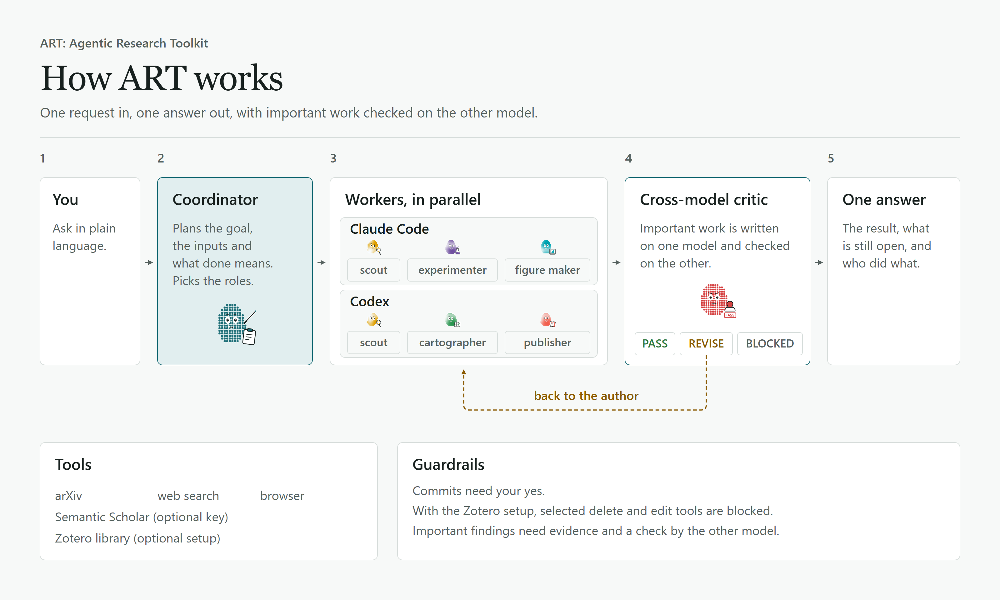

A project template for giving AI assistants the skills and tools a project needs. Skills describe how to do a task. MCP servers give an assistant access to a browser, academic papers, or web search and extraction.

## Quick start

Open your project in Claude Code or Codex and paste:

> Set up https://github.com/apattichis/agentic-research-toolkit in this project for Claude Code and Codex, with all skills, the arXiv, Firecrawl and Playwright servers, and the project rules. Preview the changes first, preserve existing settings, and tell me which tools you verified.

Using only one of the two? Name just that one. Prefer to run the installer yourself? See [Installation](docs/installation.md).

## What you get

With ART's skills and project rules installed in both, and each client's own delegation tools available, Claude Code and Codex work as one research team that follows a single rulebook. You ask in plain language. A coordinator plans the work, hands the parts to specialist workers on either platform, and sends important results to a critic on the other model before you see them.

| Included | What it does |
| --- | --- |
| **18 skills** | Guides an agent loads when a task needs one, such as how to verify a source, review a draft or make a publication figure. See [Skills](docs/skills.md). |
| **3 MCP servers** | Connections that give agents real tools: arXiv for papers, Firecrawl for web search and pages, and Playwright for a real browser. See [MCP servers](docs/mcp-servers.md). Zotero can be added once per machine; see [Skills](docs/skills.md). |
| **One rulebook** | [templates/AGENTS.md](templates/AGENTS.md): the rules both clients follow, covering the coordinator workflow, cross-model critics, figure checks, the idea routine and safety rules. |
| **An installer** | [install.py](install.py): copies the skills, server settings and rules into a project for Claude Code, Codex or Cursor, and stops instead of overwriting anything you changed. |

## Meet the crew

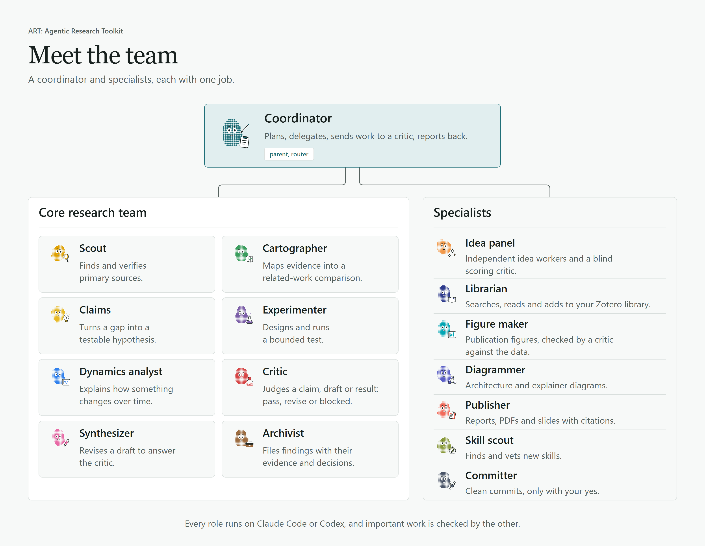

- **Coordinator** (`parent`, `router`): plans the goal, the inputs and what done means, picks the roles, and reports back with a record of who did what.
- **Core research team**: scout, cartographer, claims, experimenter, dynamics analyst, critic, synthesizer and archivist.
- **Specialists**: an idea panel (independent idea workers, one of them following `research-ideation`, and a blind scoring critic), a librarian (`zotero-library`), a figure maker (`nature-figure`), a diagrammer (`diagram-design`), a publisher for reports and slides (`quarto-authoring`), a skill scout (`find-skills`) and a committer (`git-commit`).

<table>
<tr>
<td align="center" width="25%">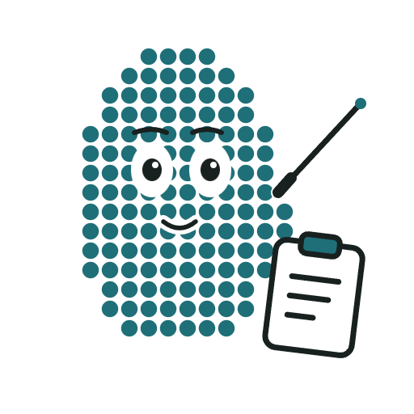 <b>Coordinator</b> Calm conductor. Plans the work and keeps everyone on track.</td>
<td align="center" width="25%">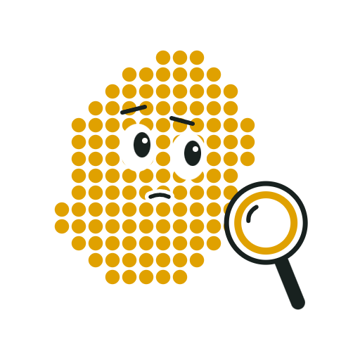 <b>Scout</b> Curious and sceptical. Checks every claim against its source.</td>
<td align="center" width="25%"> <b>Cartographer</b> Sees the big picture. Turns a pile of papers into a map.</td>
<td align="center" width="25%"> <b>Claims</b> Sharp thinker. Turns a gap into a testable question.</td>
</tr>
<tr>
<td align="center">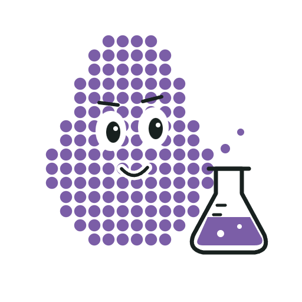 <b>Experimenter</b> Hands-on tinkerer. Runs the test before believing it.</td>
<td align="center">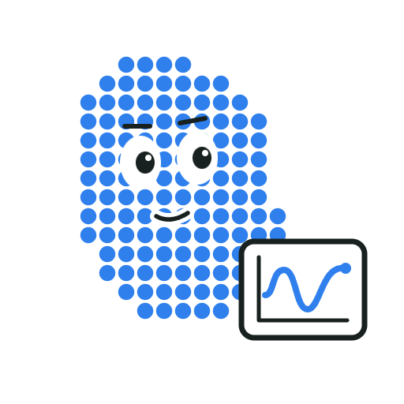 <b>Dynamics analyst</b> Pattern spotter. Watches how things change over time.</td>
<td align="center">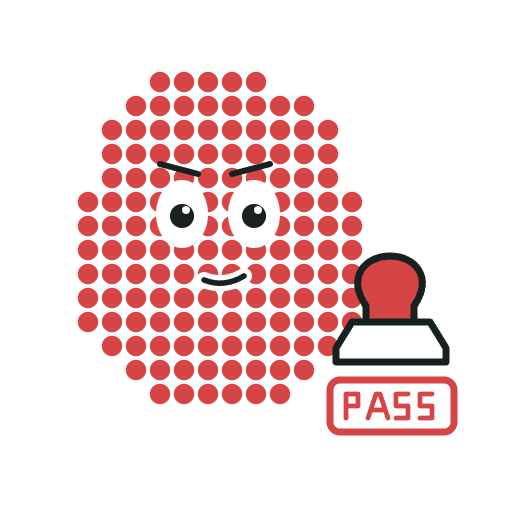 <b>Critic</b> Tough but fair. Important work gets a second look.</td>
<td align="center">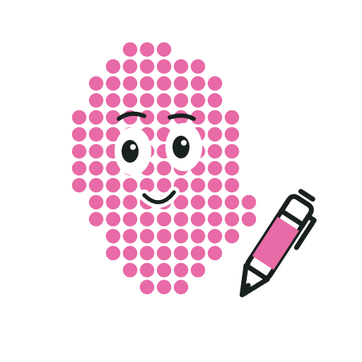 <b>Synthesizer</b> The rewriter. Turns feedback into a better draft.</td>
</tr>
<tr>
<td align="center"> <b>Archivist</b> Keeps the records. Every finding filed with its evidence.</td>
<td align="center">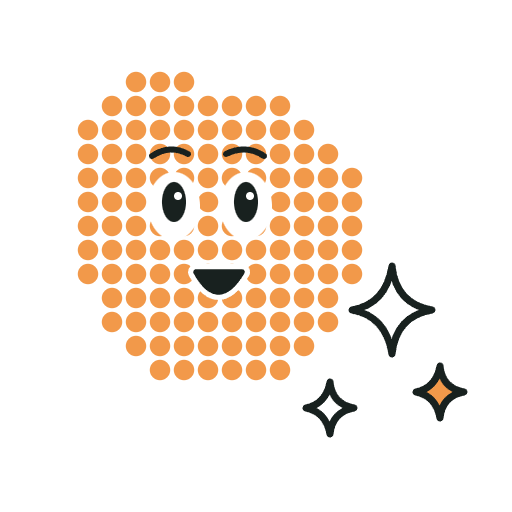 <b>Idea panel</b> Brainstorm squad. Many ideas, scored blind.</td>
<td align="center"> <b>Librarian</b> Knows your library. Adds papers, never deletes yours.</td>
<td align="center">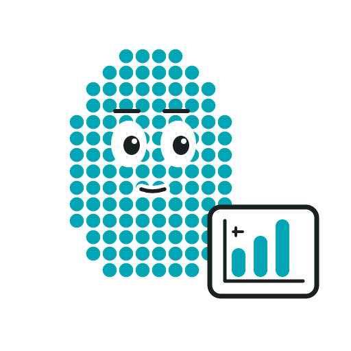 <b>Figure maker</b> Precise artist. Its charts are checked against the data.</td>
</tr>
<tr>
<td align="center">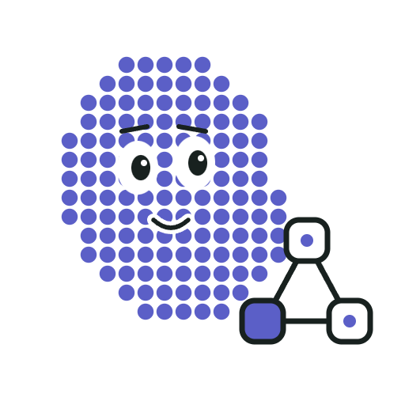 <b>Diagrammer</b> Draws how everything connects.</td>
<td align="center">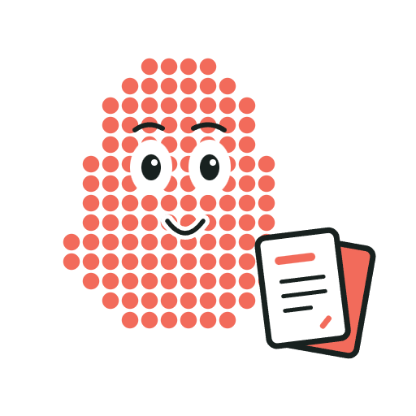 <b>Publisher</b> Turns results into reports and slides.</td>
<td align="center">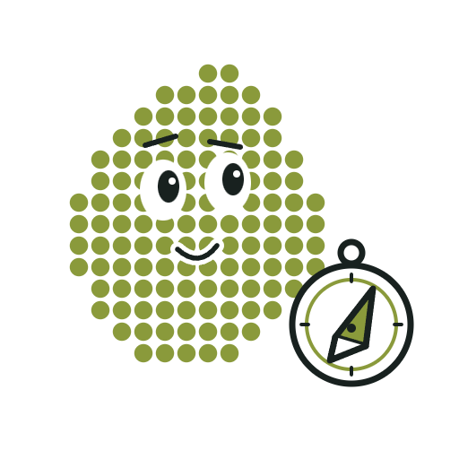 <b>Skill scout</b> Explorer. Finds new tools worth trying.</td>
<td align="center">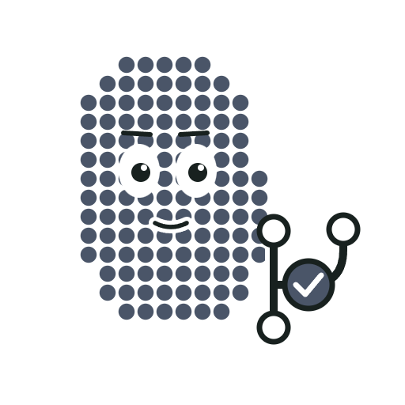 <b>Committer</b> Tidy and careful. Commits only with your yes.</td>
</tr>
</table>

## How a task runs

1. You ask Claude Code or Codex.
2. The coordinator plans and delegates, in parallel where the parts are independent.
3. Workers run on Claude Code, Codex or both.
4. A critic on the other model returns PASS, REVISE or BLOCKED. Revisions go back to the author and are checked again.
5. You get one answer: the result, what is still open, and who did what.

Team formats: solo for quick questions, a delegated team by default, cross-model review, the idea panel, and debate teams in which Claude Code teammates challenge each other (available, not yet tested).

## Safety rules

These are instructions in the project rules (`--rules`), plus the Zotero settings described in [Skills](docs/skills.md):

- Agents show you the commit message and commit only after you approve it.
- With that Zotero setup, selected tools that delete or edit existing items are blocked in both clients. The rules forbid using the remaining collection tool to remove a paper from a collection, and forbid other destructive actions. Agents can add papers and fill the project's collection.
- Findings need evidence, and important work is checked by a critic that did not write it. The rules ask for this check; they cannot guarantee that every mistake is caught.

## Tested

Four skill choices were tested head-to-head against two or three alternatives each, with blind critics on the other platform: research ideation, publication figures, paper review and slides. No challenger clearly beat the chosen tools. Both clients passed the same checks in a working project, and on the test machine fresh sessions of each set ART up within minutes from the repository link and a one-line request. The results are in [docs/evidence.md](docs/evidence.md).

## Limits

- **Cross-model review needs both clients.** Claude Code and Codex must both be installed and signed in, each on its own plan. With only one, the cross-model checks cannot run.
- **A team uses more of your plan.** Every worker and critic is its own session, and work on a client stops while its usage limit is reached.
- **Early release.** Tested on Windows 11 only; debate teams and the Cursor client are not tested yet.

## Status and roadmap

ART is at version 0.1.0, a pre-release: the first release is planned but not yet tagged. It works and is tested, but expect changes. Next on the list: head-to-head trials for literature search, surveys and experiments; testing debate teams and the Cursor client; and new skills, added only after they hold up in trials. Changes are recorded in [CHANGELOG.md](CHANGELOG.md).

## Guides

| Guide | What it covers |
| --- | --- |
| [Installation](docs/installation.md) | Set up by asking your assistant, start a project, installer options, and how to verify each client. |
| [Skills](docs/skills.md) | The skill catalogue, sources and licenses, and the Zotero library setup. |
| [MCP servers](docs/mcp-servers.md) | arXiv, Firecrawl and Playwright, and how to opt in. |
| [Workflows](docs/workflows.md) | A small research workflow, delegating a research project, agent teams, and why there is one coordinator. |
| [Evidence](docs/evidence.md) | The skill trials and checks behind the choices in ART. |
| [Changelog](CHANGELOG.md) | Versions and what changed. |

## License and trademarks

ART is released under the [MIT License](LICENSE). Third-party skills keep their own licenses, included in each skill folder. Claude Code is a product of Anthropic and Codex is a product of OpenAI; ART is an independent project and is not affiliated with either.
